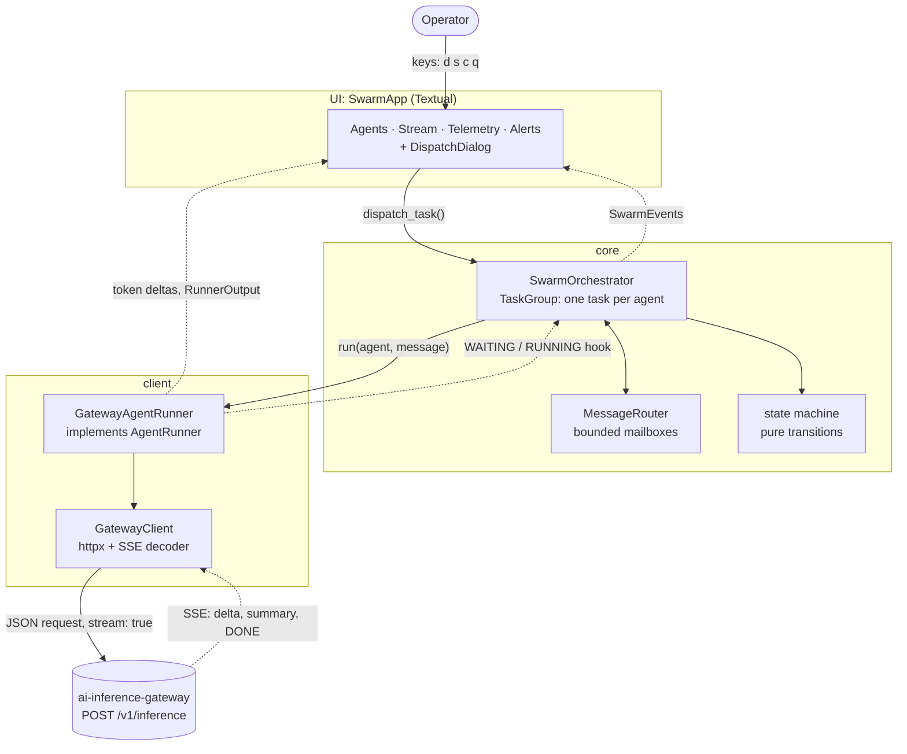
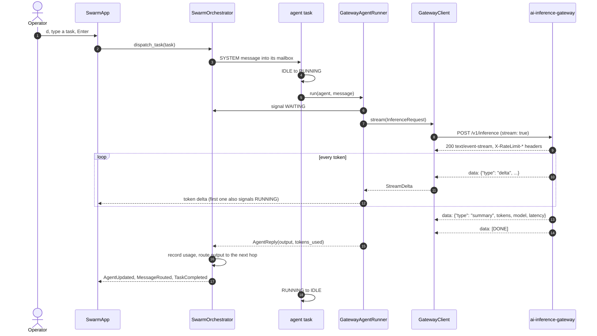
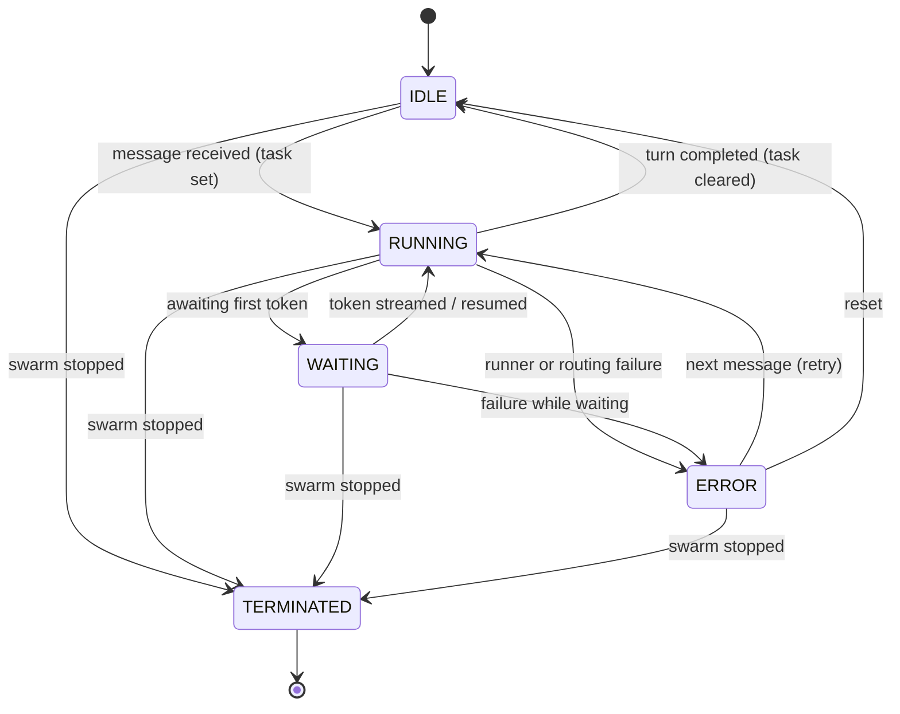
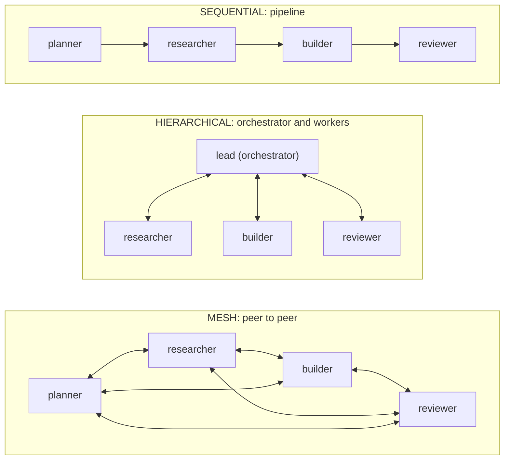
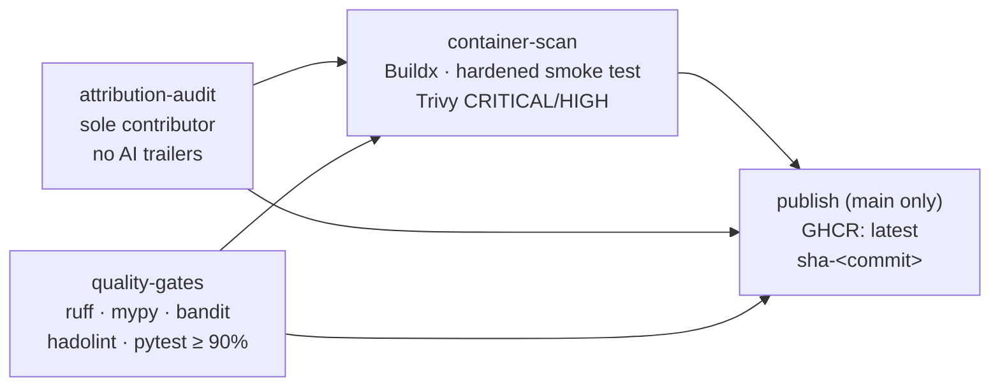

# agent-swarm-tui

**AI Systems Blueprint: repository 02/20.** A real-time terminal dashboard for
running a **multi-agent swarm** on top of
[ai-inference-gateway](https://github.com/mikeZ98/ai-inference-gateway) (repository 01). You pick a
topology, dispatch a task, and watch every agent think, hand work to its
peers, and spend tokens, live, as the gateway streams Server-Sent Events.

- **Live, not polled:** each agent's tokens stream into the UI as the gateway
  produces them. Agent status, message traffic, token spend and rate-limit
  headroom update on every event.
- **Three routing strategies:** a sequential pipeline, an orchestrator with
  workers (hierarchical), or peer-to-peer (mesh), all enforced by the router.
  An agent cannot message a peer the topology forbids.
- **Safe by construction:** immutable, strict Pydantic v2 schemas; a pure
  agent state machine; per-agent failure containment; a hermetic test suite
  with 99.87% branch coverage; a non-root, pip-free, read-only container; and
  SHA-pinned CI with an image vulnerability scan.

---

## Contents

- [Architecture](#architecture)
- [Streaming a task through the gateway](#streaming-a-task-through-the-gateway)
- [Agent lifecycle](#agent-lifecycle)
- [Routing strategies](#routing-strategies)
- [The terminal UI](#the-terminal-ui)
- [Core invariants](#core-invariants)
- [Quickstart](#quickstart)
- [CLI reference](#cli-reference)
- [Keyboard controls](#keyboard-controls)
- [Configuration](#configuration)
- [Running in a container](#running-in-a-container)
- [Verification and quality metrics](#verification-and-quality-metrics)
- [DevSecOps and supply chain](#devsecops-and-supply-chain)
- [Project layout](#project-layout)
- [Limitations and roadmap](#limitations-and-roadmap)

---

## Architecture

Everything runs on one asyncio event loop: the Textual UI, the orchestrator,
one task per agent, and the HTTP streams. The core never imports the UI or
the HTTP client. It depends only on an `AgentRunner` port, and the gateway
client implements that port.



| Package | Responsibility |
|---|---|
| `schemas/` | Frozen, strict domain models: `AgentState`, `SwarmMessage`, `SwarmTopology`, `SwarmMetrics`. |
| `core/` | State machine, `MessageRouter`, `SwarmOrchestrator`, typed events and errors, the `AgentRunner` port. |
| `client/` | `GatewayClient` (httpx and a bounded SSE decoder), the wire contracts, `GatewayAgentRunner`, settings. |
| `widgets/` | The four panels and the dispatch dialog. They only display data and never call the orchestrator. |
| `app.py` | `SwarmApp` wires the panels to the swarm; `main()` is the CLI. |

Every orchestrator event, token delta and gateway result reaches the UI as a
Textual message. They are processed in one FIFO order, so a turn's tokens
can never interleave with the next turn's.

## Streaming a task through the gateway



**The wire contract is Repo 01's.** A stream is `delta*`, then exactly one
`summary`, then `data: [DONE]`. An `error` frame replaces the summary when the
upstream model fails mid-stream. Failures before the stream starts arrive as
HTTP statuses with an `{"error": {...}}` body.

Every failure surfaces as a typed `SwarmError` subclass, never as an httpx
exception:

| Condition | Exception | Retryable |
|---|---|---|
| Connect, read, write or pool timeout, or the overall stream deadline | `GatewayTimeoutError` | yes |
| Connection refused or dropped mid-stream | `GatewayConnectionError` | yes |
| HTTP 429 (with `Retry-After` and `X-RateLimit-*`) | `GatewayRateLimitError` | yes |
| Any other non-2xx status | `GatewayHTTPError` | from the gateway's `retryable` |
| `error` frame after the stream started | `GatewayStreamError` | from the gateway's `retryable` |
| Malformed SSE or JSON, a truncated stream, a non-SSE 200 | `GatewayProtocolError` | no |

The SSE decoder follows the WHATWG spec:
- Lines may end with `\r\n`, `\n` or `\r`, including bare-CR framing and CRLF split across chunks.
- A raw U+2028 inside JSON does not end a line.
- It is bounded at 1,048,576 characters per line or event and rejects invalid UTF-8.
- Inbound frames are read tolerantly: unknown fields and frame types are ignored, while violations in known fields are rejected.

## Agent lifecycle



- **Pure:** every transition rebuilds the state with `AgentState.model_validate`.
  An illegal move, or a result that breaks the schema, raises
  `InvalidStateTransitionError`, which carries the agent id, source, target and
  reason. Inputs are never mutated.
- **Task rules, enforced by the schema:** `RUNNING` requires a `current_task`,
  and `IDLE`/`TERMINATED` forbid one. `WAITING -> RUNNING` resumes the same
  task, and `ERROR -> RUNNING` retries it.
- **Runners may only toggle `RUNNING` and `WAITING`** (`signal_status`). Every
  other transition belongs to the orchestrator.
- **Failure is contained per agent:** a runner exception moves that agent to
  `ERROR` and raises an alert, and the swarm keeps running. Only a bug in the
  core loop itself stops the swarm, and that surfaces as `SwarmError` (exit
  code 1).

## Routing strategies



| Strategy | Direct message | Broadcast | Default next hop for an agent's output | Task entry point |
|---|---|---|---|---|
| `SEQUENTIAL` | only to the next step | rejected | the successor; the last step's output is the result | first agent |
| `HIERARCHICAL` | orchestrator and worker only, never worker to worker | orchestrator only, to every worker | workers report to the orchestrator; the orchestrator's output is the result | the orchestrator |
| `MESH` | any peer | any agent, to all peers | none (output is the result unless forwarded explicitly) | first agent |

`SYSTEM` messages, the tasks you dispatch, come from the swarm runtime and
skip these rules: they reach one agent, or every agent when untargeted.

Delivery never blocks. A batch of messages is validated and checked against
mailbox capacity first, then delivered completely or not at all. A full
mailbox raises `RoutingError` instead of waiting for space, so two agents
messaging each other cannot deadlock.

**Hierarchical delegation:** when the orchestrator receives a new task, its
plan is broadcast to every worker. The workers' reports flow back to it, and
its synthesis is the result.

## The terminal UI

```text
┌───────────────────────────────────────────────────────────────────────────────────────┐
│ agent-swarm-tui — demo · sequential · 4 agents · running         20:14:03             │
├────────────────────────────────────┬──────────────────────────────────────────────────┤
│ Agents                             │ Stream · all agents                              │
│ ▼ demo  sequential  4 agents  ▶ 1  │  20:14:01 ⇒ task → planner  Plan a launch        │
│   1. ▶ RUNNING  planner  — Plan a… │ planner (planner) ────────────────────────────── │
│   2. ○ IDLE  researcher  10 tok    │  Break the launch into three milestones…         │
│   3. ○ IDLE  builder               │  20:14:02 ✉ planner → researcher  Break the…     │
│   4. ○ IDLE  reviewer              │ ┄┄┄┄┄┄┄┄┄┄┄┄┄┄┄┄┄┄┄┄┄┄┄┄┄┄┄┄┄┄┄┄┄┄┄┄┄┄┄┄┄┄┄┄┄┄┄┄ │
│                                    │ ▶ researcher  streaming…                         │
│                                    │  Market sizing suggests three segments…          │
├────────────────────────────────────┼──────────────────────────────────────────────────┤
│ Telemetry                          │ Alerts                              ⚠ 1  ✖ 0     │
│  Active       1 / 4                │  20:13:58 ● SYSTEM      swarm 'demo' started     │
│  Messages     2                    │  20:14:00 ⚠ RATE-LIMIT  gateway returned HTTP    │
│  Tokens       1,240                │                         429 (retry in 9s)        │
│  Cost (est.)  $0.0037              │                                                  │
│  Calls        2 · 0 cached (0%)    │                                                  │
│  Last call    vllm/stub · 412 ms   │                                                  │
│  Rate limit   █████████░ 54/60     │                                                  │
│  Resets in    43s                  │                                                  │
├────────────────────────────────────┴──────────────────────────────────────────────────┤
│ q Quit   d Dispatch task   s Scroll lock   c Clear                    ^p palette      │
└───────────────────────────────────────────────────────────────────────────────────────┘
```

| Panel | Shows |
|---|---|
| **Agents** (thread monitor) | A tree laid out per strategy: numbered pipeline steps, workers nested under the orchestrator, or flat peers. Each row has a coloured status badge, role, task snippet and token count; the root shows live running, waiting and error counts. **Enter** focuses the stream on one agent; Enter on the root shows the whole swarm. |
| **Stream** | Each agent's turn under a titled rule, with one dim line per routed message. In-flight tokens render in a live area (repainted at most 15 times a second) that moves into the history when the turn ends. The title shows the focus and the scroll lock. |
| **Telemetry** | Active agents, messages, tokens, estimated cost, gateway calls and cache hits, the last call's model and latency, and rate-limit headroom (green, yellow, red) with a live reset countdown, or the retry time when the limit is exhausted. |
| **Alerts** | Routing and schema violations, illegal state changes, and gateway failures. Retryable conditions (429, timeouts, dropped connections) are warnings; everything else is an error. The border shows the counts. |

**Responsive layout:**
- 170 or more columns: the left column is 76 wide.
- 120 to 169 columns: it is 64 wide.
- Below 120: the panels stack vertically.

All text from agents and models is rendered as literal text. A payload such as
`[bold red]x[/][link=…]` cannot inject styles or links.

## Core invariants

- **Sole contributor:** every commit's author and committer is exactly
  `mikeZ98 <145975972+mikeZ98@users.noreply.github.com>`, with no AI trailers
  or signatures of any kind. `scripts/attribution.sh` enforces this in the
  `pre-commit`, `commit-msg` and `pre-push` hooks and again in CI (see
  [CONTRIBUTING.md](CONTRIBUTING.md)).
- **Immutable domain schemas:** every model is `frozen`, `extra="forbid"` and
  `strict` (no type coercion). Cross-field rules are validated, for example
  "RUNNING requires a task", "DIRECT needs a distinct target", "HIERARCHICAL
  needs exactly one orchestrator". Bounds: at most 64 agents, payloads up to
  65,536 characters.
- **Pure state transitions:** a fixed transition table; new states are rebuilt
  and revalidated, never mutated.
- **Strict network isolation in tests:** an autouse fixture blocks every socket
  `connect`, so an accidental real call fails loudly (a test proves the guard
  works). The developer's `GATEWAY_*` environment is cleared, and all HTTP goes
  through `httpx.MockTransport`.
- **No orphaned work:** shutdown drains or cancels every agent task. On any
  exit path, including an abrupt one, the app hard-stops the swarm and closes
  the HTTP pool. The tests assert that no task outlives the app.
- **Storage isolation (development):** `.envrc` pins every cache, virtualenv,
  temp directory and Docker/Colima state to the external SSD.

## Quickstart

Requirements: [`uv`](https://docs.astral.sh/uv/), [`direnv`](https://direnv.net/),
and a running ai-inference-gateway (repository 01).

```sh
direnv allow                 # pins caches to ./.cache/, installs git hooks, sets identity
uv sync                      # creates ./.cache/venv (runtime + dev dependencies)

uv run agent-swarm-tui                                   # gateway at http://127.0.0.1:8000
uv run agent-swarm-tui --topology hierarchical \
    --task "Design a caching layer for a REST API"       # dispatch on start
uv run agent-swarm-tui --gateway-url http://127.0.0.1:9000 --model mistral-small-latest
python -m agent_swarm_tui --version
```

## CLI reference

| Flag | Default | Meaning |
|---|---|---|
| `--gateway-url URL` | `$GATEWAY_BASE_URL`, else `http://127.0.0.1:8000` | Gateway base URL. Credentials in the URL, query strings and fragments are rejected. |
| `--topology {sequential,hierarchical,mesh}` | `sequential` | Preset four-agent swarm (see [Routing strategies](#routing-strategies)). |
| `--name NAME` | `swarm` | Swarm name shown in the header. |
| `--task TEXT` | none | Dispatch this task as soon as the swarm starts (must not be blank). |
| `--model MODEL` | gateway routing | Explicit model override, sent as `model`. |
| `--temperature T` | gateway default | Sampling temperature, 0 to 2. |
| `--max-tokens N` | gateway default | Max output tokens per agent turn (1 to 32,768). |
| `--cost-per-million USD` | `0.0` | Price per million tokens, for the cost estimate. |
| `--drain-timeout SECONDS` | `10.0` | How long the first `q` waits for in-flight work before cancelling it. |
| `--log-file PATH` | Textual devtools | Write logs to a file. Logs never reach the terminal while the UI runs. |
| `--log-level LEVEL` | `WARNING` | `DEBUG`, `INFO`, `WARNING` or `ERROR`. |
| `--version` | | Print the version and exit. |

The presets:
- `sequential`: planner → researcher → builder → reviewer.
- `hierarchical`: a `lead` orchestrator over researcher, builder and reviewer.
- `mesh`: the same four agents as peers.

**Exit codes:**
- `0`: graceful quit.
- `1`: the swarm crashed or failed to start.
- `2`: invalid configuration or arguments, reported with a readable message.

## Keyboard controls

| Key | Action |
|---|---|
| `d` | Open the **dispatch dialog**: a task field and a target-agent picker, preset to the strategy's entry point. `Enter` dispatches, `Esc` cancels, and an empty task shows an inline error. Inside the dialog, every key types into the field. |
| `s` | Toggle **scroll lock** on the stream. |
| `c` | **Clear** the stream history and the alerts. |
| `q` | **Quit in three stages:** (1) drain: finish queued and in-flight work, including forwarded messages, for up to `--drain-timeout`; (2) cancel in-flight work now; (3) exit immediately. `ctrl+q` does the same. |
| `Enter` (agent tree) | Focus the stream on the selected agent; on the root, show the whole swarm. |
| `ctrl+p` | Textual command palette (theme, screenshot, ...). |

`d`, `s` and `c` are disabled while the dialog is open. `d` is greyed out
whenever the swarm is not running.

## Configuration

The gateway client reads `GATEWAY_*` environment variables
(pydantic-settings). Unknown `GATEWAY_*` variables, such as the gateway
server's own settings, are ignored.

| Variable | Default | Notes |
|---|---|---|
| `GATEWAY_BASE_URL` | `http://127.0.0.1:8000` | The `--gateway-url` flag takes precedence. |
| `GATEWAY_CONNECT_TIMEOUT_S` | `5` | |
| `GATEWAY_READ_TIMEOUT_S` | `120` | Maximum silence between SSE chunks, including time to the first token. |
| `GATEWAY_WRITE_TIMEOUT_S` / `GATEWAY_POOL_TIMEOUT_S` | `10` / `10` | |
| `GATEWAY_STREAM_TIMEOUT_S` | `300` | Overall deadline for one request, enforced mid-stream. |
| `GATEWAY_MAX_CONNECTIONS` | `64` | Connection pool size. |
| `GATEWAY_AUTH_TOKEN` | unset | Sent as `Authorization: Bearer …` (for a proxy in front of the gateway). Refused over plain `http` to a non-loopback host. |
| `GATEWAY_TRUST_ENV` | `false` | Honour `HTTP(S)_PROXY`, `NO_PROXY` and `.netrc`. |

## Running in a container

The image is built from the repository's `Dockerfile`. It is about 56 MB
uncompressed. It defaults to `GATEWAY_BASE_URL=http://gateway:8000` (the
gateway's compose service name) and writes logs to `/tmp`.

```sh
# 1. Start the gateway stack from its own repository.
(cd ../ai-inference-gateway && docker compose up -d)

# 2. Run the TUI attached to a pseudo-TTY, on the gateway's network.
docker compose run --rm tui
docker compose run --rm tui --topology hierarchical --task "Design a cache"
```

`compose.yaml` runs the service with:
- `stdin_open: true` and `tty: true`, plus `init: true` so signals reach the app;
- a read-only root filesystem with a 16 MB `noexec` tmpfs on `/tmp`;
- uid `10001`, all capabilities dropped, `no-new-privileges`, and process and memory limits.

It joins the gateway's network, `ai-inference-gateway_default`; override it
with `GATEWAY_NETWORK`. Without compose:

```sh
docker run --rm -it --read-only --tmpfs /tmp:size=16m,mode=1777,noexec,nosuid,nodev \
  --cap-drop ALL --security-opt no-new-privileges:true --user 10001:10001 --init \
  -e GATEWAY_BASE_URL=http://host.docker.internal:8000 \
  agent-swarm-tui:local --topology sequential
```

## Verification and quality metrics

**320 tests, 99.87% branch coverage, fully offline.** All 1,877 statements are
executed. The only 3 partial branches left are provably unreachable: the SSE
frame dispatch and the event dispatch are already exhaustive, and a Pydantic
`ValidationError` never has zero errors. A full
run takes about 16 seconds.

| Test module | Tests | Covers |
|---|---:|---|
| `test_schemas.py` | 45 | strictness, immutability, bounds and cross-field contracts |
| `test_state_machine.py` | 40 | every one of the 25 status pairs, task carry-over, pure updates |
| `test_router.py` | 18 | every strategy rule, atomic batches, mailbox bounds, shutdown |
| `test_orchestrator.py` | 36 | lifecycle, barrier-proven concurrency, drain/cancel/abort, concurrent stops, crashes |
| `test_gateway_client.py` | 78 | SSE edge cases (bare CR, split CRLF, U+2028, BOM), HTTP errors, rate-limit headers, deadlines, the network guard |
| `test_runner.py` | 19 | prompt templating, the WAITING hook, `RunnerOutput`, reply policies |
| `test_widgets.py` | 43 | rendering, markup safety, `AgentSelected`, reactive updates, alert classification |
| `test_app.py` | 21 | full Pilot flows: keys, dispatch dialog, breakpoints, 3-stage quit, abrupt exit, exit codes |
| `test_cli.py` | 20 | argument parsing, configuration errors (exit 2), headless `main()` (exit 0), logging |

Every async scenario also asserts that no agent task outlives it. The quality
gates, run identically in CI:

```sh
uv run ruff check . && uv run ruff format --check .
uv run mypy --strict src/ tests/
uv run bandit -c pyproject.toml -r src/
uv run pytest --cov=agent_swarm_tui --cov-branch --cov-report=term-missing --cov-fail-under=90
```

## DevSecOps and supply chain

**Container (`Dockerfile`, multi-stage):**

| Property | Implementation |
|---|---|
| Base | `python:3.13-slim` and `uv 0.11.7`, both pinned by digest. |
| Builder | `uv sync --frozen --no-dev` into `/opt/venv`; the project is installed as a regular wheel, with bytecode precompiled. |
| Runtime contents | `/opt/venv` only: no pip, no `ensurepip` wheels, no uv, no sources, no tests, no dev tools. |
| User | `10001:10001` (`appuser`); `/opt/venv` is root-owned and not writable by it. |
| Filesystem | Works with `read_only: true`. `HOME`, `TMPDIR`, the XDG directories and the working directory are `/tmp`, the only writable path. Checked by auditing every file write. |
| Build context | A deny-all `.dockerignore` allowlist (`pyproject.toml`, `uv.lock`, `README.md`, `src/`): about 300 kB. |
| Lint | `hadolint` is clean at the strictest threshold (`info`). |

**CI (`.github/workflows/ci.yml`):**



- **Pinned actions:** every action is pinned to a full 40-character commit SHA
  with a version comment. Each pin was checked to match its release tag, to be
  GitHub-verified and to be at least 7 days old.
- **Permissions:** `contents: read` globally. `packages: write` goes only to the
  `publish` job, which runs only on a push to `main`, after every other job.
- **Trivy v0.76.0:** fails the build on any fixable CRITICAL or HIGH
  vulnerability. Python dependencies scan clean. Debian packages with no
  upstream fix are excluded (`ignore-unfixed`), because rebuilding cannot
  remediate them.
- **Publish:** GHCR receives the exact image that was smoke-tested and scanned:
  `ghcr.io/mikez98/agent-swarm-tui:latest` and `:sha-<commit>`.
- **Workflow audits:** the workflow itself passes `actionlint` (with
  shellcheck) and `zizmor --persona pedantic`.

## Project layout

```text
src/agent_swarm_tui/
  schemas/      agent.py  message.py  topology.py  metrics.py  base.py (StrictModel)
  core/         state_machine.py  router.py  orchestrator.py  events.py  ports.py  errors.py
  client/       gateway.py  sse.py  protocol.py  runner.py  settings.py  errors.py
  widgets/      agent_tree.py  streaming_log.py  token_tracker.py  alerts.py  dispatch_dialog.py
  app.py        SwarmApp + CLI (main)
  presets.py    the three four-agent topologies
tests/          320 hermetic tests (conftest: network guard, mock SSE gateway)
scripts/        attribution.sh (single source of the contributor invariant)
.githooks/      pre-commit, commit-msg, pre-push
Dockerfile, compose.yaml, .dockerignore, .github/workflows/ci.yml
```

## Limitations and roadmap

- **No automatic retries.** Retryable failures (429, timeouts) mark the agent
  `ERROR` and raise an alert; the next message retries. Backoff that honours
  `Retry-After` is a natural next step.
- **Cost is an estimate**, at one flat price per million tokens
  (`--cost-per-million`). Per-model pricing is not modelled.
- **In-memory sessions.** Swarm state, history and results (the last 256) are
  lost when the app exits.
- **Fixed presets from the CLI.** Custom topologies are available through the
  Python API (`SwarmApp(SwarmTopology(...))`); loading them from a file is not
  implemented yet.
- **`WAITING` comes from the runner.** It appears with `GatewayAgentRunner`.
  Custom runners opt in by implementing `StatusAwareRunner`.
